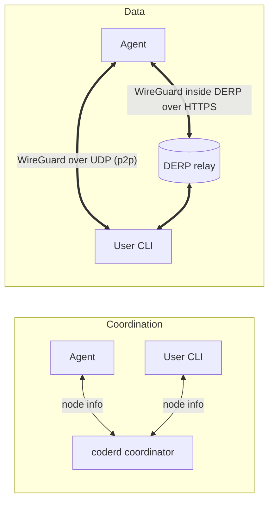
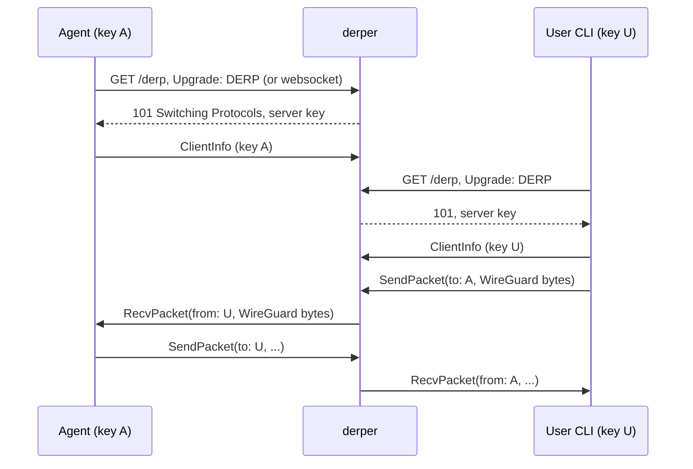
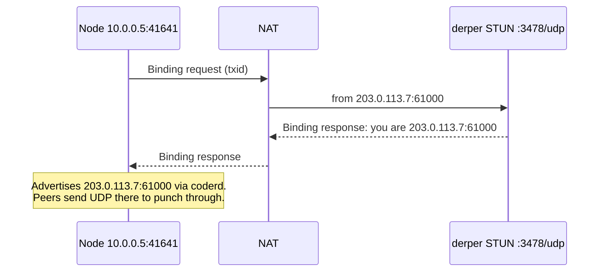
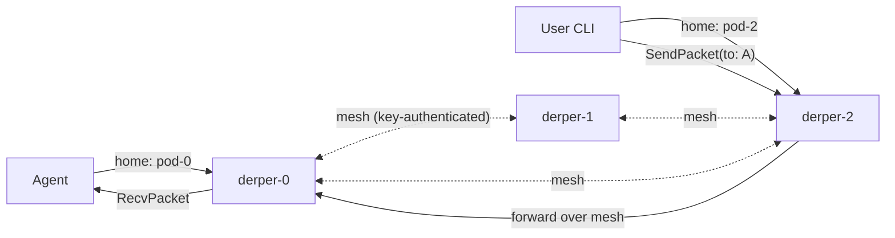
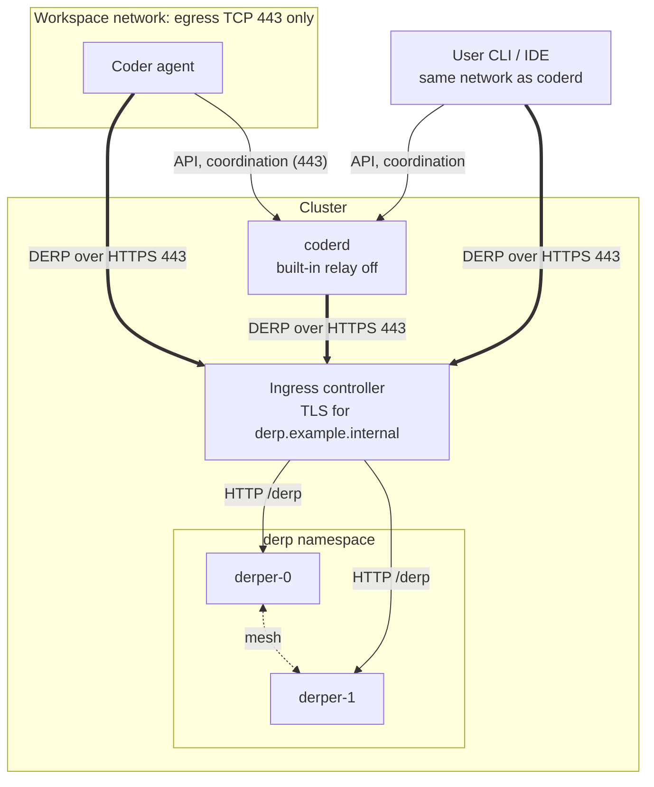

# How the DERP relay works with Coder

New to networking? Start with [networking-basics.md](networking-basics.md).

- [Coder networking in one page](#coder-networking-in-one-page)
- [DERP](#derp)
- [STUN](#stun)
- [Choosing a home relay](#choosing-a-home-relay)
- [Replicas and meshing](#replicas-and-meshing)
- [The production layout](#the-production-layout)
- [Enabling direct connections (UDP)](#enabling-direct-connections-udp)
- [Do we need the patch?](#do-we-need-the-patch)
- [What was tested](#what-was-tested)

## Coder networking in one page

Coder connects users and coderd to workspaces over a private WireGuard network built on Tailscale's libraries.
Every participant is a node with a WireGuard key pair:
the workspace agent, each CLI or IDE session, and coderd itself (for the dashboard terminal, apps and port forwarding).

There are two planes:

| Plane | Carries | Path |
|---|---|---|
| Coordination | Node keys, each node's home relay, candidate UDP endpoints | Each node's API connection to coderd |
| Data | WireGuard packets | Direct UDP between nodes (p2p), or through a DERP relay |



WireGuard encrypts end to end between the two nodes.
A relay forwards packets it cannot read.
It sees the node public keys, the source addresses of the connections and the traffic volume.

coderd also publishes the **DERP map**: the list of relay regions, their hostnames and ports.
`CODER_DERP_CONFIG_PATH` adds regions from a file; `CODER_DERP_SERVER_ENABLE=false` removes coderd's built-in relay (region 999).

## DERP

DERP (Designated Encrypted Relay for Packets) is a packet relay addressed by WireGuard public key.
A node opens one long-lived HTTPS connection to a relay and keeps it open.
To send to a peer, it hands the relay a packet tagged with the peer's public key;
the relay writes it down the peer's connection.



- The connection is ordinary HTTP/1.1 upgraded to the DERP protocol, so it passes through HTTP reverse proxies and ingress controllers that forward upgrades.
- If the upgrade fails, Coder's client retries over a websocket on the same `/derp` path. `CODER_DERP_FORCE_WEBSOCKETS=true` makes it start there.
- Only TCP is used. The relay works where UDP is blocked.
- The relay keeps no state beyond the open connections.

## STUN

STUN tells a node its address as seen from outside its NAT.
Nodes advertise those addresses through coderd so peers can try direct UDP (p2p) connections, which skip the relay.



- `derper` answers only requests carrying Tailscale's `tailnode` software attribute.
- STUN must see the client's real source address, hence `externalTrafficPolicy: Local` on its Service.
- A node that cannot send UDP gets nothing from STUN and cannot connect directly to anyone; all its traffic goes through a relay.

## Choosing a home relay

Each node runs a network check (netcheck) on start and periodically:

1. With UDP, it measures each region's latency with STUN.
2. Without UDP, it measures latency over HTTPS (`GET /derp/latency-check`), trying the region's nodes in order.
3. The lowest-latency region becomes its **home relay**. If nothing answers, it picks a region at random.

A node stays connected to its home relay and tells coderd which one it is.
To reach a peer through a relay, a node connects to the **peer's** home region (opening a second relay connection if needed) and sends there.
So every node must be able to reach every region that any of its peers might call home.

## Replicas and meshing

With several `derper` pods behind one hostname, two peers can land on different pods.
Meshing connects the pods to each other: each pod opens a watch connection to every pod, authenticated with the mesh key, and learns which clients each pod holds.
A packet for a client on another pod is forwarded over that mesh connection.



The chart addresses each pod through the headless `<release>-coder-derper-mesh` Service.
Without meshing, the test client's packets between peers on different pods time out.

## The production layout

coderd, workspaces and users all reach the relay through the ingress.
Workspaces may only egress on TCP 443.



- The DERP map has one region (900) with one node, `derp.example.internal:443`, and no STUN port.
- The agent cannot send UDP, so it never connects directly to anyone. Every connection to a workspace is relayed.
- All three kinds of client pick region 900 by HTTPS latency, since it is the only region.
- The ingress terminates TLS; the pods serve plain HTTP and mesh over plain HTTP inside the cluster.
- Workspaces and coderd must trust the CA that signed the ingress certificate.
- A workspace egress NetworkPolicy matches the ingress controller pod's port after NAT (8443 for Traefik), not 443, when the controller runs in the same cluster.

## Enabling direct connections (UDP)

With UDP allowed, the CLI and the agent try a direct WireGuard path and keep DERP as the fallback.
The browser (dashboard terminal, apps) always goes through coderd and is unaffected.

```mermaid
sequenceDiagram
  participant U as User CLI (LAN)
  participant S as derper STUN (UDP 3478)
  participant C as coderd
  participant A as Agent (pod, SNAT to node IP)
  U->>S: STUN binding
  S-->>U: you are 10.1.0.20:53000
  A->>S: STUN binding
  S-->>A: you are 10.2.0.5:41000 (node IP after SNAT)
  U->>C: my endpoints: 10.1.0.20:53000
  A->>C: my endpoints: 10.2.0.5:41000, pod IP
  C-->>U: agent endpoints
  C-->>A: user endpoints
  par hole punch
    U->>A: UDP probe to 10.2.0.5:41000
  and
    A->>U: UDP probe to 10.1.0.20:53000
  end
  Note over U,A: WireGuard runs directly over UDP;<br/>DERP stays connected as fallback
```

Firewall rules, in addition to TCP 443 to the ingress, for a stateful firewall where only the workspace network (B) may start connections to the users' network (A):

| From | To | Protocol / port | For |
|---|---|---|---|
| B (workspaces) | STUN Service address | UDP 3478 | Workspace learns its outside address |
| B (workspaces) | User subnets | UDP 1024 to 65535 | Direct WireGuard, opened from B |
| (optional) B | coderd | UDP 1024 to 65535 | Direct path for dashboard terminal and apps |
| A to B | nothing | replies only | |

- The user side opens the path by sending CallMeMaybe through the relay; the agent then sends UDP to the user's endpoints, and the firewall treats the user's packets as replies.
- Firewall state for UDP expires after its idle timeout; while a session is active both sides send disco heartbeats every 3 seconds.
- The CLI binds a random UDP port and has no option to fix it, so the B-to-users rule cannot be narrower than the high port range. `CODER_AGENT_TAILNET_LISTEN_PORT` fixes only the agent's port.
- A NAT in front of the agent that changes the port per destination ("hard" NAT) can still prevent the direct path; Coder falls back to DERP.
- Without these rules, keep `stun.enabled=false`, and set `CODER_BLOCK_DIRECT=true` on coderd to stop clients attempting direct paths.

Chart and Coder settings:

```bash
helm upgrade derp ./chart -n derp --reuse-values \
  --set stun.enabled=true \
  --set derpMap.stunIPv4=<STUN Service external IP>   # when it differs from the ingress address
```

The ingress cannot carry UDP, so STUN gets its own LoadBalancer Service (`stunService`).
With `derpMap.stunIPv4` set, the DERP map gains a STUN-only region next to the relay region.

For a workspace NetworkPolicy in the same cluster as the STUN Service, allow UDP 3478 to the `derper` pods (the destination after NAT), plus UDP to the user networks by `ipBlock`.

`coder ping <workspace>` reports `p2p via <ip:port>` once the direct path is up; `coder netcheck` shows `"UDP": true`.

## Do we need the patch?

[The patch](../patches/0001-mesh-with-urls.patch) changes only how `derper` dials its mesh peers.
The client-facing protocol is unchanged.

Unpatched, `-mesh-with` takes hostnames and dials each as `https://<host>/derp` on port 443, using the hostname both for the connection and for TLS verification.
That cannot address an individual pod behind a shared hostname:

| Layout | Unpatched mesh entry | Result |
|---|---|---|
| Ingress, pods plain HTTP | `derp.example.internal` | Reaches a random pod through the ingress, not each pod |
| Ingress, pods plain HTTP | `derp-0.derp-mesh.derp.svc` | HTTPS to a plain-HTTP pod fails |
| LoadBalancer, pods TLS | `derp-0.derp-mesh.derp.svc` | `derper` rejects the TLS name: it accepts only `hostname` |

The patch lets an entry be a full URL (`http://derp-0.derp-mesh.derp.svc:8443/derp`), optionally with `|<dial address>` to connect to one pod while verifying TLS for the shared hostname.

| Replicas | Patch needed |
|---|:---:|
| 1 | ❌ |
| 2+ behind one hostname | ✅ |
| 2+ as separate regions | ❌ |

Separate regions avoid meshing: give each replica its own hostname (and ingress rule or Service), and list each as its own region in the DERP map.
Clients home on whichever answers fastest and connect to a peer's region when needed.
That costs one hostname and certificate per replica, and a client whose replica fails re-homes after its next network check.

Bumping `CODER_TAILSCALE_REF` re-applies the patch; the image build fails if it no longer applies.

## What was tested

On k3s 1.36 with Traefik, the patched image and 3 replicas:

| Test | Result |
|---|:---:|
| Two clients on different pods relay to each other (DERP and websocket), LoadBalancer and Ingress modes | ✅ |
| Same test against two unmeshed relays | ❌ (expected) |
| Workspace-like pod limited to TCP 443: UDP and direct pod access blocked, region 900 chosen by HTTPS latency | ✅ |
| Coder 2.39.1, built-in relay off, workspace limited to TCP 443 plus coderd: `coder ping` via `DERP(Custom DERP)` | ✅ |
| Same: `coder ssh` | ✅ |
| Same: coderd to agent (`/api/v2/workspaceagents/<id>/listening-ports`) | ✅ |
| Same, before the change: relayed via `DERP(Coder Embedded Relay)`, no p2p | ✅ |

coderd outage, with a `coder ssh` session printing a line every second, coderd scaled to 0 for 4 minutes and back:

| Relay | Open session during outage | New connection during outage | Open session after coderd returns |
|---|:---:|:---:|:---:|
| This chart (custom DERP) | ✅ 319 lines over 5m21s, no gap over 2 s | ❌ | ✅ |
| coderd built-in relay | ❌ stopped 3 s after coderd went down | ❌ | ❌ |

Open sessions need only the relay; coderd is needed to exchange keys for new connections.
A client keeps known peers while coderd is unreachable and drops one after 15 minutes without a WireGuard handshake; an active session handshakes every few minutes.
