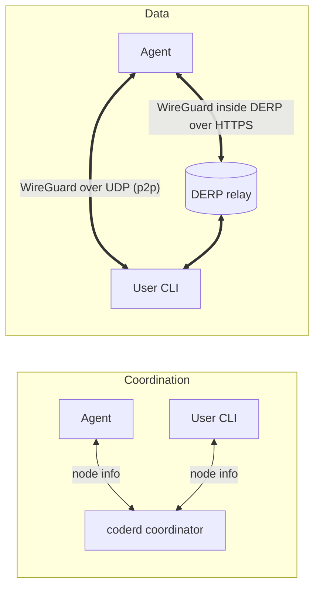
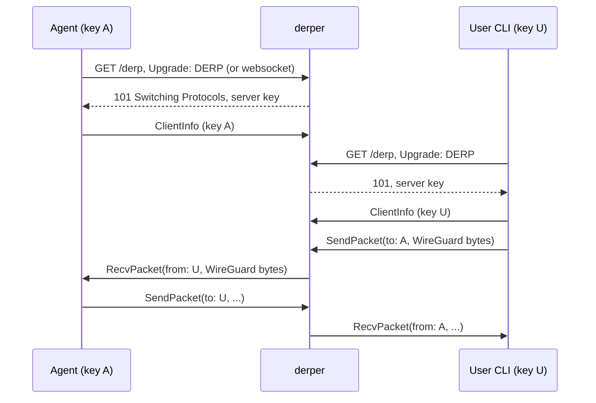
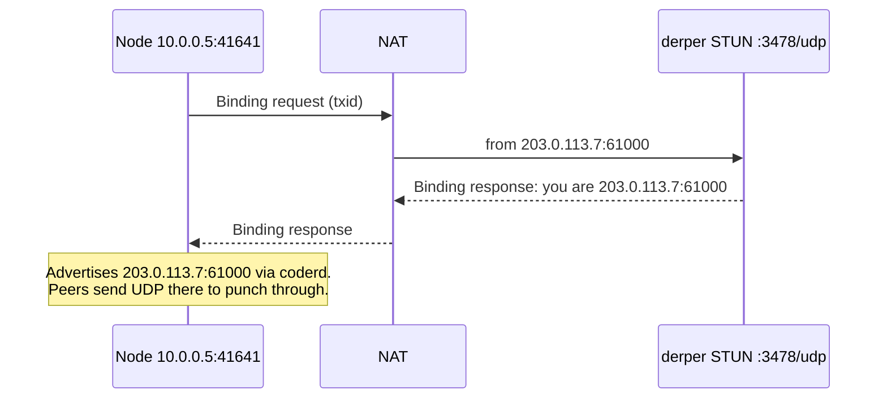
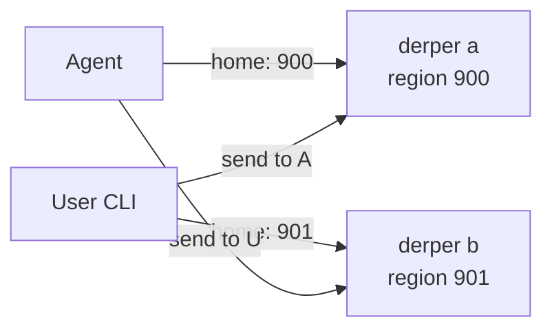
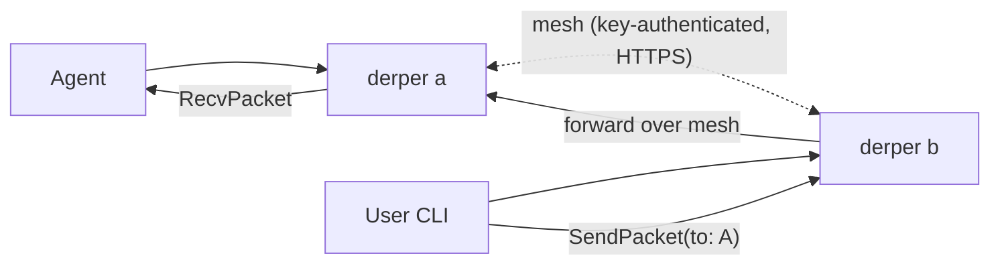
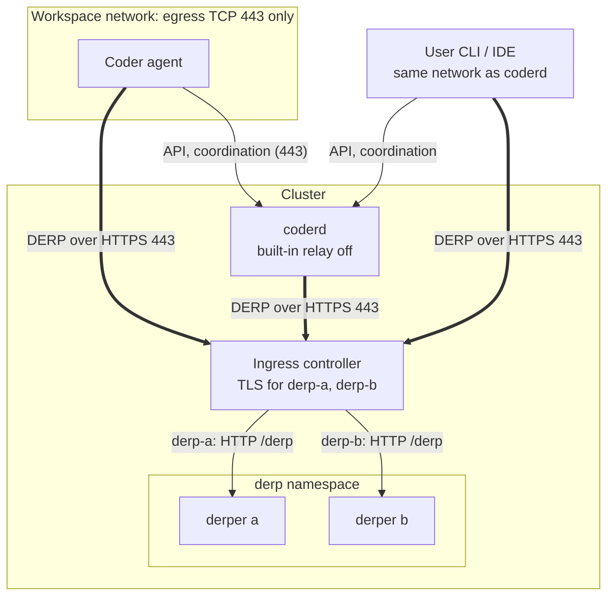

# How the DERP relay works with Coder

New to networking? Start with [networking-basics.md](networking-basics.md).

- [Coder networking in one page](#coder-networking-in-one-page)
- [DERP](#derp)
- [STUN](#stun)
- [Choosing a home relay](#choosing-a-home-relay)
- [Nodes, regions and meshing](#nodes-regions-and-meshing)
- [The production layout](#the-production-layout)
- [Enabling direct connections (UDP)](#enabling-direct-connections-udp)
- [Upstream derper and Coder](#upstream-derper-and-coder)
- [What was tested](#what-was-tested)

## Coder networking in one page

Coder connects users and coderd to workspaces over a private WireGuard network built on Tailscale's libraries.
Every participant is a node with a WireGuard key pair:
the workspace agent, each CLI or IDE session, and coderd itself (for the dashboard terminal, apps and port forwarding).

There are two planes:

| Plane | Carries | Path |
|---|---|---|
| Coordination | Node keys, each node's home relay, candidate UDP endpoints | Each node's API connection to coderd |
| Data | WireGuard packets | Direct UDP between nodes (p2p), or through a DERP relay |



WireGuard encrypts end to end between the two nodes.
A relay forwards packets it cannot read.
It sees the node public keys, the source addresses of the connections and the traffic volume.

coderd also publishes the **DERP map**: the list of relay regions, their hostnames and ports.
`CODER_DERP_CONFIG_PATH` adds regions from a file; `CODER_DERP_SERVER_ENABLE=false` removes coderd's built-in relay (region 999).

## DERP

DERP (Designated Encrypted Relay for Packets) is a packet relay addressed by WireGuard public key.
A node opens one long-lived HTTPS connection to a relay and keeps it open.
To send to a peer, it hands the relay a packet tagged with the peer's public key;
the relay writes it down the peer's connection.



- The connection is ordinary HTTP/1.1 upgraded to the DERP protocol, so it passes through HTTP reverse proxies and ingress controllers that forward upgrades.
- If the upgrade fails, Coder's client retries over a websocket on the same `/derp` path. `CODER_DERP_FORCE_WEBSOCKETS=true` makes it start there.
- Only TCP is used. The relay works where UDP is blocked.
- The relay keeps no state beyond the open connections.

## STUN

STUN tells a node its address as seen from outside its NAT.
Nodes advertise those addresses through coderd so peers can try direct UDP (p2p) connections, which skip the relay.



- `derper` answers only requests carrying Tailscale's `tailnode` software attribute.
- STUN must see the client's real source address, hence `externalTrafficPolicy: Local` on its Service.
- A node that cannot send UDP gets nothing from STUN and cannot connect directly to anyone; all its traffic goes through a relay.

## Choosing a home relay

Each node runs a network check (netcheck) on start and periodically:

1. With UDP, it measures each region's latency with STUN.
2. Without UDP, it measures latency over HTTPS (`GET /derp/latency-check`), trying the region's nodes in order.
3. The lowest-latency region becomes its **home relay**. If nothing answers, it picks a region at random.

A node stays connected to its home relay and tells coderd which one it is.
To reach a peer through a relay, a node connects to the **peer's** home region (opening a second relay connection if needed) and sends there.
So every node must be able to reach every region that any of its peers might call home.

## Nodes, regions and meshing

Each entry in `nodes` is one `derper` pod with its own hostname, Service and (behind an ingress) Ingress.
`derpMap.layout` decides how they appear in the DERP map.

**region-per-node** (default): each node is its own region, numbered from `derpMap.regionID` in list order.
Every client measures every region and homes on the fastest, so clients spread across the nodes.
A peer reaches a client by connecting to the client's home region, so the nodes need no mesh.
If a node fails, its clients re-home at their next network check.



Regions in other clusters work the same way: they are more entries in the same DERP map, and clients home on the fastest.
Nodes in different regions never mesh, so clusters need no connection to each other.

**single-region**: one region listing the nodes in order.
Clients dial the first node that answers; websocket clients use only the first node.
The other nodes are failover, and the nodes mesh so clients on different nodes reach each other:
each node opens a watch connection to every node, authenticated with the mesh key, and forwards packets for clients it does not hold.



`derper` meshes over HTTPS only, verifying each node's hostname.
With TLS in the pods, the chart dials each node's Service; behind an ingress, it dials the ingress (`mesh.ingressDialHost`, or the hostname).
Without TLS at either, the chart refuses `single-region` with more than one node.

## The production layout

coderd, workspaces and users all reach the relay through the ingress.
Workspaces may only egress on TCP 443.



- The DERP map has one region per node (900 `derp-a.example.internal:443`, 901 `derp-b.example.internal:443`), and no STUN port.
- The agent cannot send UDP, so it never connects directly to anyone. Every connection to a workspace is relayed.
- Each client picks its home region by HTTPS latency.
- The ingress terminates TLS; the pods serve plain HTTP.
- Workspaces and coderd must trust the CA that signed the ingress certificate.
- A workspace egress NetworkPolicy matches the ingress controller pod's port after NAT (8443 for Traefik), not 443, when the controller runs in the same cluster.

## Enabling direct connections (UDP)

With UDP allowed, the CLI and the agent try a direct WireGuard path and keep DERP as the fallback.
The browser (dashboard terminal, apps) always goes through coderd and is unaffected.

```mermaid
sequenceDiagram
  participant U as User CLI (LAN)
  participant S as derper STUN (UDP 3478)
  participant C as coderd
  participant A as Agent (pod, SNAT to node IP)
  U->>S: STUN binding
  S-->>U: you are 10.1.0.20:53000
  A->>S: STUN binding
  S-->>A: you are 10.2.0.5:41000 (node IP after SNAT)
  U->>C: my endpoints: 10.1.0.20:53000
  A->>C: my endpoints: 10.2.0.5:41000, pod IP
  C-->>U: agent endpoints
  C-->>A: user endpoints
  par hole punch
    U->>A: UDP probe to 10.2.0.5:41000
  and
    A->>U: UDP probe to 10.1.0.20:53000
  end
  Note over U,A: WireGuard runs directly over UDP;<br/>DERP stays connected as fallback
```

Firewall rules, in addition to TCP 443 to the ingress, for a stateful firewall where only the workspace network (B) may start connections to the users' network (A):

| From | To | Protocol / port | For |
|---|---|---|---|
| B (workspaces) | STUN Service address | UDP 3478 | Workspace learns its outside address |
| B (workspaces) | User subnets | UDP 1024 to 65535 | Direct WireGuard, opened from B |
| (optional) B | coderd | UDP 1024 to 65535 | Direct path for dashboard terminal and apps |
| A to B | nothing | replies only | |

- The user side opens the path by sending CallMeMaybe through the relay; the agent then sends UDP to the user's endpoints, and the firewall treats the user's packets as replies.
- Firewall state for UDP expires after its idle timeout; while a session is active both sides send disco heartbeats every 3 seconds.
- The CLI binds a random UDP port and has no option to fix it, so the B-to-users rule cannot be narrower than the high port range. `CODER_AGENT_TAILNET_LISTEN_PORT` fixes only the agent's port.
- A NAT in front of the agent that changes the port per destination ("hard" NAT) can still prevent the direct path; Coder falls back to DERP.
- Without these rules, keep `stun.enabled=false`, and set `CODER_BLOCK_DIRECT=true` on coderd to stop clients attempting direct paths.

Chart and Coder settings:

```bash
helm upgrade derp ./chart -n derp --reuse-values \
  --set stun.enabled=true \
  --set derpMap.stunIPv4=<STUN Service external IP>   # when it differs from the ingress address
```

The ingress cannot carry UDP, so STUN gets its own LoadBalancer Service (`stunService`).
With `derpMap.stunIPv4` set, the DERP map gains a STUN-only region next to the relay region.

For a workspace NetworkPolicy in the same cluster as the STUN Service, allow UDP 3478 to the `derper` pods (the destination after NAT), plus UDP to the user networks by `ipBlock`.

`coder ping <workspace>` reports `p2p via <ip:port>` once the direct path is up; `coder netcheck` shows `"UDP": true`.

## Upstream derper and Coder

The image is `derper` from `github.com/tailscale/tailscale` at a release tag, unpatched.
Coder agents and clients use the `github.com/coder/tailscale` fork.
Both speak DERP protocol version 2 with the same frame types, and upstream `derper` serves what Coder clients call:
`/derp` (DERP upgrade and websocket with the `derp` subprotocol), `/derp/probe` and `/derp/latency-check`.

Upstream `-mesh-with` takes `<host>[:port]/<dial host>` entries: TLS is verified for `host` and the connection goes to `dial host`.
That addresses each node through its Service or the ingress.

## What was tested

Upstream `derper` v1.106.1, on k3s 1.36 with Traefik and two nodes.
The test client is `derphttp` from `coder/tailscale` at the commit Coder 2.39.1 pins, one client on each node, sending a packet from one to the other.

| Test | DERP | Websocket |
|---|:---:|:---:|
| Ingress per node, TLS at Traefik, `single-region`, mesh through Traefik, clients in a pod | ✅ | ✅ |
| Same, clients on the LAN | ✅ | ✅ |
| Same, `region-per-node`: both clients on one node | ✅ | |
| Same, `region-per-node`: clients on different nodes | ❌ (expected, no mesh) | |
| TLS in the pods from cert-manager, `single-region`, mesh through the node Services | ✅ | ✅ |
| TLS in the pods from `kubernetes.io/tls` Secrets made from crt/key files, private CA in `tls.ca.secretName` | ✅ | ✅ |

`/derp/latency-check` answered 200 through the ingress.

Earlier, with `derper` built from `coder/tailscale` and replicas behind one hostname:

| Test | Result |
|---|:---:|
| Workspace-like pod limited to TCP 443: UDP and direct pod access blocked, region 900 chosen by HTTPS latency | ✅ |
| Coder 2.39.1, built-in relay off, workspace limited to TCP 443 plus coderd: `coder ping` via `DERP(Custom DERP)` | ✅ |
| Same: `coder ssh` | ✅ |
| Same: coderd to agent (`/api/v2/workspaceagents/<id>/listening-ports`) | ✅ |
| Same, before the change: relayed via `DERP(Coder Embedded Relay)`, no p2p | ✅ |

coderd outage, with a `coder ssh` session printing a line every second, coderd scaled to 0 for 4 minutes and back:

| Relay | Open session during outage | New connection during outage | Open session after coderd returns |
|---|:---:|:---:|:---:|
| This chart (custom DERP) | ✅ 319 lines over 5m21s, no gap over 2 s | ❌ | ✅ |
| coderd built-in relay | ❌ stopped 3 s after coderd went down | ❌ | ❌ |

Open sessions need only the relay; coderd is needed to exchange keys for new connections.
A client keeps known peers while coderd is unreachable and drops one after 15 minutes without a WireGuard handshake; an active session handshakes every few minutes.
