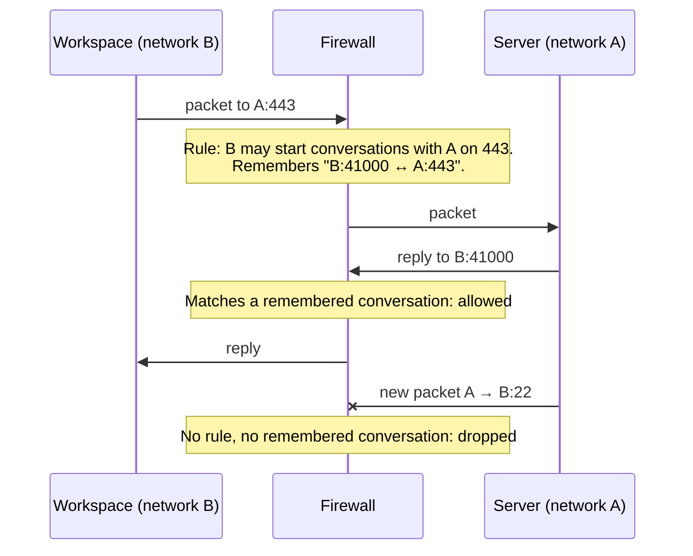
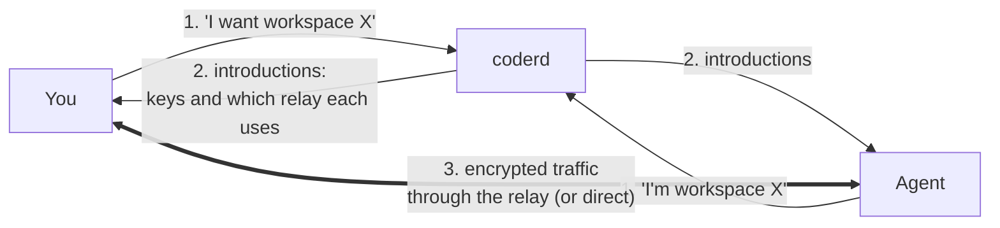
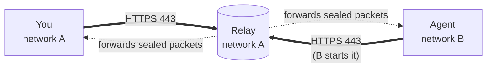
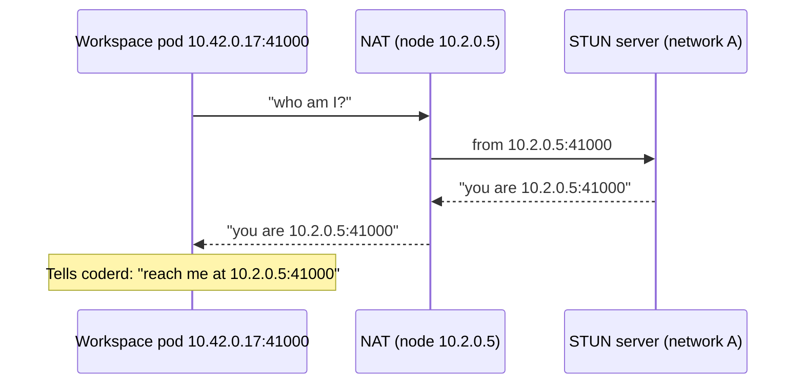
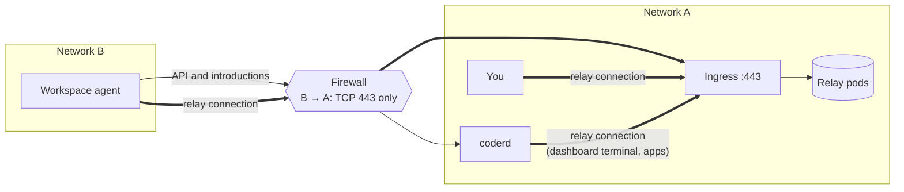

# Networking basics for the Coder relay

A plain-language guide to what the relay does and why the firewall rules look the way they do.
No networking background assumed.
For the technical version see [how-it-works.md](how-it-works.md).

- [Packets, addresses and ports](#packets-addresses-and-ports)
- [TCP and UDP](#tcp-and-udp)
- [Firewalls: who may start a conversation](#firewalls-who-may-start-a-conversation)
- [NAT: sharing one address](#nat-sharing-one-address)
- [How Coder connects you to a workspace](#how-coder-connects-you-to-a-workspace)
- [DERP: the relay](#derp-the-relay)
- [STUN: "what address do I look like?"](#stun-what-address-do-i-look-like)
- [Your network](#your-network)
- [Should you allow UDP?](#should-you-allow-udp)
- [Glossary](#glossary)

## Packets, addresses and ports

Everything on a network travels as **packets**: small chunks of data with a label on the front.
The label says where the packet came from and where it is going, as an **address** and a **port**:

```
from 10.1.0.20 port 53000   →   to 10.2.0.5 port 443
     (your laptop)                  (a server)
```

- The **address** (IP address) picks the machine.
- The **port** picks the program on that machine. Port 443 is HTTPS by convention, 3478 is STUN.
- The sender's port is usually a random high number (1024 to 65535) picked for that conversation.

## TCP and UDP

Two ways of sending packets:

| | TCP | UDP |
|---|---|---|
| Like | A phone call | Posting letters |
| Setup | Both sides agree a connection first | None; just send |
| Lost packets | Re-sent automatically | Gone |
| Used here for | HTTPS, the relay (DERP) | STUN, direct WireGuard connections |

WireGuard, the encryption Coder uses between you and your workspace, prefers UDP.
It can also be carried inside a TCP connection, which is what the relay does.

## Firewalls: who may start a conversation

A firewall sits between two networks and decides which packets may pass.
Almost all firewalls are **stateful**: they remember conversations.



So "network A cannot start conversations with network B" still lets A **reply** to anything B started.
That is how your workspaces already reach the relay over TCP 443.
Firewalls also remember UDP "conversations" for a short while (often 30 to 180 seconds) after the last packet.

## NAT: sharing one address

**NAT** (network address translation) lets many machines share one outside address.
Kubernetes does this for pods: a packet leaving a workspace pod has its sender rewritten from the pod's address to the node's address.

```
inside:   pod 10.42.0.17 port 41000  ──►  NAT  ──►  node 10.2.0.5 port 41000  :outside
```

The NAT remembers the mapping, so replies to `10.2.0.5:41000` find their way back to the pod.
Nobody outside can reach the pod at `10.42.0.17` directly; they only ever see `10.2.0.5`.

## How Coder connects you to a workspace

Three parties talk to each other:

- **coderd** (the controller): the website and API. It also **introduces** you to the workspace.
- **The agent**: a small program running inside every workspace.
- **You**: the `coder` CLI, VS Code or JetBrains on your machine. (The browser goes through coderd instead.)



1. You and the agent each keep a connection open to coderd.
2. coderd swaps your details: your encryption keys and which relay each of you is using.
3. From then on, your traffic goes between you and the agent, encrypted end to end with WireGuard. It does not pass through coderd.

Once step 2 is done, coderd is no longer needed for that session.
That is why an open session survived coderd being down for four minutes in testing.

## DERP: the relay

The relay (DERP) is like a post office box service:

- You and the agent each open a TCP connection to the relay on port 443 and keep it open.
- To reach the agent, you hand the relay a sealed envelope addressed to the agent's key.
- The relay pushes it down the agent's open connection.



- The envelopes are WireGuard-encrypted; the relay cannot read them.
- Both sides **start** their own connection to the relay, so it works even when nobody can start a connection to the workspace.
- It uses only TCP 443, the same as a web page, so it passes through strict firewalls and ingress controllers.

## STUN: "what address do I look like?"

For a **direct** connection (no relay), you and the agent must send UDP packets straight to each other.
To do that, each needs to know the address the other appears as from outside, after NAT.

STUN is a mirror: you send it a packet and it replies "your packet came from address X, port Y".



STUN does not carry any of your traffic.
It only helps the two sides find each other for a direct path.
Without UDP, STUN is useless and everything goes through the relay, which is fine.

## Your network

- **Network A**: you, coderd, the relay (and STUN, if enabled).
- **Network B**: the workspace pods.
- B may start TCP 443 connections to A. A may not start anything towards B.



Everything the workspace does is started from B, so it all works within the rule.
Your traffic to the workspace goes: you → relay → (down the connection the workspace opened) → workspace.
The relay is in network A next to you, so the extra hop is short: about 1 ms in testing.

## Should you allow UDP?

Direct connections need UDP between you and the workspace.
With "A may not start anything towards B", a direct path can still form:
the workspace sends UDP to you first (asked to via the relay), the firewall remembers it, and your packets back count as replies.

But the workspace has to be allowed to send UDP to **your** machine, on **whatever port your CLI picked**.
The `coder` CLI picks a random port each time and has no setting to fix it.
So the narrowest rule is:

| From | To | Protocol / ports |
|---|---|---|
| Network B | STUN server address | UDP 3478 |
| Network B | The subnets your users sit on | UDP 1024 to 65535 |

If that is not allowed, stay on the relay:

- Keep `stun.enabled=false` in the chart (as now).
- Optionally set `CODER_BLOCK_DIRECT=true` on coderd, so clients stop trying direct paths and every connection goes straight to the relay.

What you give up: a direct path skips one hop and avoids carrying WireGuard inside TCP.
With the relay on the same network as your users, that difference is small for terminals, editors and port forwards.
Large file copies may be somewhat slower through the relay; this was not measured.

## Glossary

| Term | Meaning |
|---|---|
| Agent | Coder's program inside each workspace |
| coderd | Coder's server: website, API, introductions |
| DERP | Tailscale's relay protocol; forwards encrypted packets over HTTPS |
| Direct / p2p | You and the workspace exchange UDP packets with no relay |
| Ingress | The web entry point to the cluster; terminates HTTPS |
| Mesh | Relay servers in one region connected to each other, so users on different servers can reach each other |
| NAT | Rewriting addresses so many machines share one outside address |
| Port | Number picking the program on a machine (443 = HTTPS) |
| Stateful firewall | Remembers conversations and lets replies back |
| STUN | Tells a machine what address it appears as from outside |
| TCP / UDP | Reliable connection / fire-and-forget packets |
| WireGuard | The encryption between you and your workspace |
