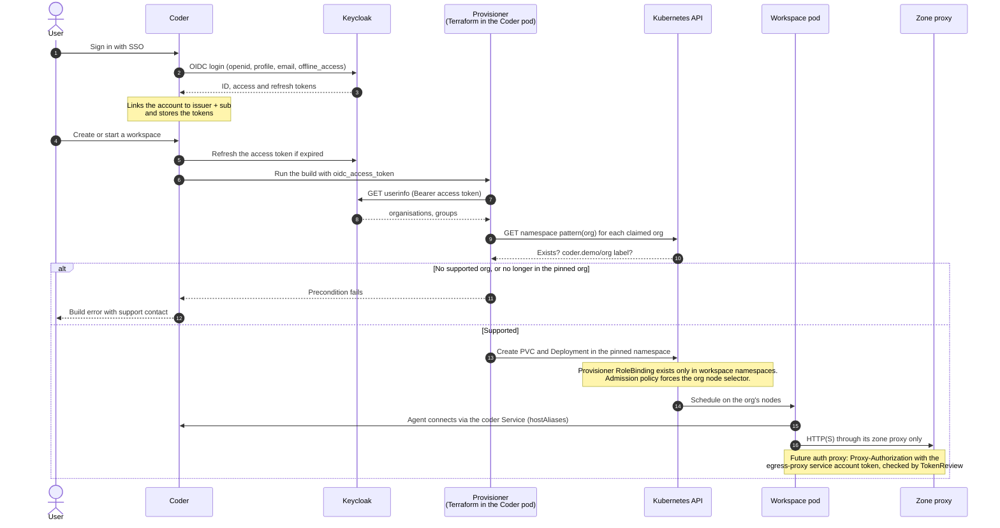
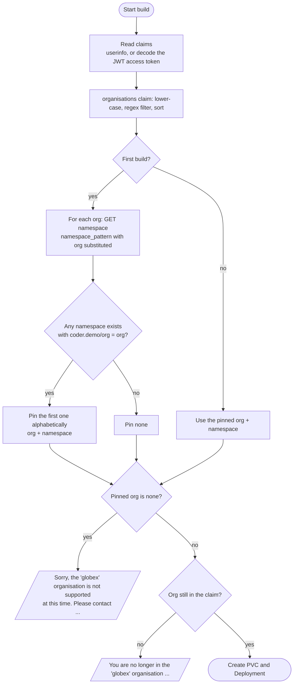

# Design

## Options

Coder templates see the owner's `name`, `email`, `groups`, `rbac_roles`, `login_type` and `oidc_access_token`.
They do not see arbitrary OIDC claims.

| Approach | Tier | Isolation |
|---|:---:|---|
| Organisation sync from `organisations`, one provisioner per org in its own namespace | Premium | Provisioner credentials per org |
| Group sync from `organisations`, template reads `groups` | Premium | Shared provisioner |
| Read the claim via `oidc_access_token` in Terraform (this repo) | OSS | Shared provisioner |

## Auth flow

Who talks to whom, from sign-in to a running workspace (`egress-zoned`, using `modules/org-mapping`).

What the build decides, and the error each branch shows.
Stop and delete skip all of it: userinfo is not called and nothing is checked.

The userinfo call fails the build on a non-200 response (`Sign out of Coder and back in to refresh your SSO session.`).
`claim-gated` adds one more check before creating the Deployment: the chosen profile's group must be in the `groups` claim. See [Group-gated profiles](#group-gated-profiles).

## Reading the claim

Coder OSS stores the ID token's claims but does not pass them, or the ID token, to templates.
The template gets the claim from the access token in one of two ways, chosen by `claim_source`.

| | `userinfo` (default) | `access_token` |
|---|:---:|:---:|
| Claim only in ID token / userinfo | ✅ | ❌ |
| Opaque access tokens | ✅ | ❌ |
| Token validated by the IdP | ✅ | ❌ |
| No network call from the provisioner | ❌ | ✅ |
| Revoked SSO session blocks start | ✅ | Until token expiry |

With `userinfo`, a `data "http"` call sends `Authorization: Bearer <access token>` to the IdP's `userinfo_endpoint` on each start.
A non-200 response fails the build.
The provisioner (the Coder pod) needs network access to that endpoint.

Microsoft Entra ID's userinfo endpoint returns only standard claims.
For Entra, issue the access token for your own API (add `api://<client-id>/<scope>` to `CODER_OIDC_SCOPES`) with the claim configured on it, and use `access_token`.

With `access_token`, `modules/oidc-claims` splits the JWT, converts base64url to padded base64, `jsondecode`s the payload, and keeps names matching `^[a-z0-9]([-a-z0-9]{0,40}[a-z0-9])?$`.

The signature is not verified in Terraform.
The token comes from Coder's database, written after Coder validated the login, and is not user input.
Anyone who can edit the template can already deploy anywhere the provisioner can, so template authors are trusted at the same level as the provisioner.

## What each phase receives

Verified against Coder v2.39.1 `coderd/provisionerdserver/provisionerdserver.go` and `coderd/dynamicparameters/render.go`.

| Phase | Owner data | OIDC token |
|---|---|:---:|
| `coder templates push` (import) | Placeholder (`default`, `login_type` null) | ❌ |
| CLI dry-run | Placeholder | ❌ |
| Dashboard parameter preview | Real name, email, groups, roles | ❌ |
| Workspace build | Real | ✅ |

The template treats a null `login_type` as import/dry-run and skips the preconditions there.
The dashboard cannot offer a per-user organisation list for the same reason, so the template has no organisation parameter.

If Coder cannot refresh the token (revoked session), the build receives an empty token, finds no organisations, and refuses to start.

## Choosing the organisation

`modules/org-mapping` (`egress-zoned`) has no list.
It maps each claimed organisation to a namespace with `namespace_pattern` and uses the first, alphabetically, that exists and carries `coder.demo/org=<org>`.
The label check stops a pattern like `<org>` from matching an unrelated namespace such as `default`.
Checking needs `get` on namespaces (`tenancy/namespace-lookup.yaml`); a missing namespace reads as empty, not as an error.
The provisioner can still only write where `tenancy/*orgs.yaml` binds it, so a namespace that exists but is not a workspace namespace fails at apply.
The namespace is pinned with the organisation, so changing `namespace_pattern` only affects new workspaces.

`org-isolated` and `claim-gated` use `var.organisations`, an allow-list in priority order.
The template intersects it with the claim and takes the first match.
It is `sensitive`, so Coder shows `*redacted*` in the API and dashboard to every user.

Template variables are set per template version by template admins, not per user, so a multi-org user cannot pick an organisation without a parameter.
Ways to give that choice back, if needed:

- One template per organisation, each with a single-entry `organisations` list.
- A mutable workspace parameter, accepting that the dropdown lists every enabled organisation.

## Group-gated profiles

`templates/claim-gated` only.
The `profile` parameter has fixed options in `local.profiles`; `modules/gated-parameter` renders them and reports whether the chosen one is allowed.
Each option may name a `required_group`.
`modules/oidc-claims` reads `groups_claim` from the same claims as `organisations` and compares exactly.
Each value goes through `group_pattern` (the first capture group is the name) and then `group_names` (a rename map).

| IdP | Groups claim | `group_pattern` | `group_names` |
|---|---|---|---|
| Keycloak | `groups`, full paths (`/USER_DEVELOPER`) | default `^/?(.+)$` | – |
| Entra ID | `groups`, object IDs | default | object ID → name |
| PingFederate (LDAP) | often `memberOf`, DNs (`CN=USER_DEVELOPER,OU=…`) | `^(?i)cn=([^,]+)` | – |

Entra ID and Ping are not tested here.
Entra ID's userinfo endpoint does not return groups, so it needs `claim_source = "access_token"` with an access token issued for the Coder app registration (not Microsoft Graph), with the groups claim configured on it.
Entra ID can emit group names instead of IDs (`sAMAccountName` for synced groups, `cloud_displayname` for cloud-only groups); then `group_names` is not needed.
Over 200 groups, Entra ID leaves the claim out (group overage); `groups_overage` is then true and the profile error says so.

The check is a second precondition on the Deployment, so it runs only on start.
Stop and delete never need the group.

On a new workspace the check is deferred to apply by including the PVC's `uid`, which is unknown until the PVC exists.
The org pin and PVC are created first, and only the Deployment is refused.
Failing at plan would leave no pin; the next stop resolves the organisation without userinfo, gets `none`, and fails the PVC precondition.
Measured: bob's Developer create failed, a Standard start then succeeded with the same volume.

The dashboard parameter preview has no OIDC token, so it cannot hide options a user is not entitled to.
Coder's own `data.coder_workspace_owner.me.groups` is available in the preview, but filling it from the IdP needs Premium group sync.

In the test realm, `USER_DEVELOPER` is a Keycloak group emitted by a `groups` mapper.
The `organisations` mapper also emits all groups, so `USER_DEVELOPER` appears there too; it is dropped by the DNS-name filter and the allow-list.

## Egress zones

`templates/egress-zoned` only.
Its workspaces run in `<org>-zoned-workspaces`, separate from `<org>-workspaces`, so the other templates are unaffected.

Enforcement is two NetworkPolicies, both owned by the cluster admin:

- `egress-zone` in each workspace namespace denies all egress except cluster DNS, the Coder pods on 8080, and proxy pods in the namespace labelled `coder.demo/egress-proxy=<zone>`.
- `zone-members-only` in each `egress-<zone>` namespace accepts only namespaces labelled `coder.demo/egress-zone=<zone>`.

Changing the ConfigMap or the pod's proxy variables changes which proxy a tool tries, not which one it can reach.
The proxy's allow-list decides what the zone can reach.

The agent connects to Coder's access URL, which resolves to the ingress IP.
The policy cannot allow that IP without allowing every ingress-exposed service, so the template adds a `hostAliases` entry pointing the access URL's hostname at the `coder` Service ClusterIP, and the hostname is in `NO_PROXY`.
The provisioner cannot read Services in `coder`, so the IP is the `coder_service_ip` variable.
Direct (peer-to-peer) agent connections and STUN are blocked; connections relay through Coder.

DNS is allowed so pods can resolve the proxy and cluster names.
CoreDNS forwards external names, so a pod can still tunnel data over DNS queries.
Closing that needs a CoreDNS view that only answers `cluster.local` for these namespaces, or proxy IPs in place of names.

### Workspace identity for the auth proxy

Each pod mounts a projected service account token with audience `egress-proxy` and a 1-hour lifetime, renewed by the kubelet.
Its claims name the namespace (and so the org and zone) and the pod, whose labels carry the workspace ID and owner.
An auth proxy can validate it with the TokenReview API, or offline against the cluster's OIDC discovery (`/openid/v1/jwks`).
Clients would send it as `Proxy-Authorization: Bearer <token>`; Squid ignores it today.

### No organisation

Handled by `modules/org-mapping`, which `egress-zoned` uses.
The org pin is read from `terraform_data.org.input`, which is known at plan, so the PVC can be `count`ed on `has_org`.
A user with no enabled organisation fails the first build at plan on a precondition of the module's `start_check` resource, which exists only on start.
A later stop or delete pins `none`, creates nothing, and succeeds.
A workspace pinned to `none` never starts; the error says to delete it and create a new one.

## Lifecycle

The resolved organisation is stored in a `terraform_data` resource on the first build and ignored afterwards.
Changing `var.organisations` priority does not move existing workspaces.
The claim check is a precondition on the Deployment, which exists only while the workspace is started, and userinfo is only called on start.

Measured with alice moved from acme to globex in Keycloak after creating a workspace: stop succeeded, start failed with `no 'organisations' claim matching 'acme' (claims: ["globex"])`, the volume stayed in `acme-workspaces`, delete succeeded.

A user with no enabled organisation fails the PVC precondition at plan on the first build, so no pin is stored.
Every later stop or delete re-resolves to `none` and fails the same way; `coder delete --orphan` removes the workspace (nothing exists in Kubernetes).

## Node isolation

The template sets a `nodeSelector`, but nothing in Kubernetes stops another pod in the namespace from choosing different nodes or setting `spec.nodeName`.
Capsule's Tenant `nodeSelector` was tried first and is not enforced on k3s: it needs the `PodNodeSelector` admission plugin, which k3s does not enable.

`tenancy/node-isolation-policy.yaml` applies to namespaces labelled `coder.demo/org-isolation=enabled`:

- A MutatingAdmissionPolicy sets `coder.demo/org-<org>=true` on every pod.
- A ValidatingAdmissionPolicy rejects `spec.nodeName` and any other `coder.demo/org-*` key.

The organisation comes from the namespace's `coder.demo/org` label.
Only cluster admins should be able to edit namespace labels.

## RBAC

`coder-workspace-provisioner` is bound to `coder:coder` in each org namespace by `tenancy/orgs.yaml`.
NetworkPolicy and ResourceQuota are per namespace in the same file.
